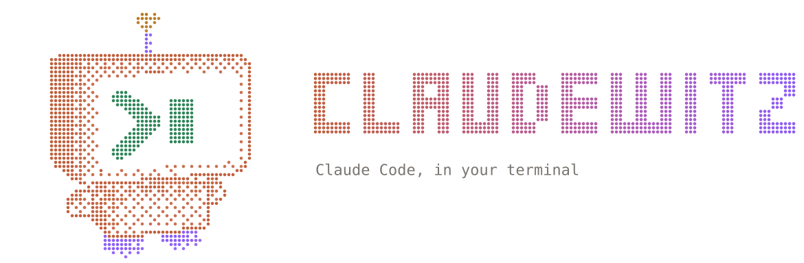

<p align="center">
  <picture>
    <source media="(prefers-color-scheme: dark)" srcset="assets/logo-dark.svg">
    
  </picture>
</p>

# claudewitz

A [Crush](https://github.com/charmbracelet/crush)-style terminal UI for **Claude Code**.

Instead of calling the Anthropic API directly (which bills per token), claudewitz drives the
`claude` CLI you already have installed. That means it runs on whatever you are logged in
with, including a Claude Pro/Max subscription, and you keep Claude Code's tools, MCP servers,
skills, hooks, `CLAUDE.md` and session history.

```
┌──────────────────────────── claudewitz (Go + Bubble Tea) ─────────────────────────────┐
│ chat viewport · input · permission dialogs · status bar (model, mode, ctx, 5h/7d usage) │
└──────────────┬──────────────────────────────────────────────────────▲───────────────────┘
   stdin: user messages, permission answers,             stdout: stream_event deltas,
   control requests (interrupt, set_model,               assistant/user messages, result,
   set_permission_mode)                                  rate_limit_event, can_use_tool
┌──────────────▼──────────────────────────────────────────────────────┴───────────────────┐
│ claude -p --input-format stream-json --output-format stream-json                        │
│        --include-partial-messages --permission-prompt-tool stdio                        │
└──────────────────────────────────────────────────────────────────────────────────────────┘
```

## Requirements

- Go 1.24+
- Claude Code CLI on your `PATH`, logged in (`npm i -g @anthropic-ai/claude-code`, then run `claude` once)

## Install

**Homebrew** (macOS and Linux):

```sh
brew install exmanubis/tap/claudewitz
```

**Prebuilt binaries** for macOS, Linux and Windows (Intel and ARM) are on the
[releases page](https://github.com/ExManubis/Claudewitz/releases): download the archive for your
platform, unpack it and put `claudewitz` somewhere on your `PATH`, e.g. `/usr/local/bin` or
`~/.local/bin`.

**With Go:**

```sh
go install github.com/exmanubis/claudewitz@latest
```

Or from a clone: `make install` (and `make uninstall`). Either way the `claudewitz` command lands
in Go's bin folder, `~/go/bin` unless you've set `GOBIN`. If that folder isn't on your `PATH` yet
(`make install` tells you), add it to your shell profile (`~/.zshrc`, `~/.bashrc`):

```sh
export PATH="$HOME/go/bin:$PATH"
```

`claudewitz -version` shows what you're running. To update: `brew upgrade claudewitz`, a newer
release archive, or `go install …@latest` again.

## Run

```sh
claudewitz                      # in the project you want to work on
claudewitz -model opus -effort high -mode acceptEdits
claudewitz -continue            # pick up the latest session in this directory
claudewitz -resume <session-id>
claudewitz -- --add-dir ../lib  # anything after -- goes straight to claude
```

From a clone without installing, `go run .` takes the same flags.

## Configuration

Settings live in `~/.config/claudewitz/config.json` on every platform (`$XDG_CONFIG_HOME/claudewitz/`
if that's set, or `$CLAUDEWITZ_CONFIG` to point at a file of your own), with prompt history in
`history.jsonl` beside it. Older versions kept these in `~/Library/Application Support/claudewitz/`
on macOS; they're moved over automatically the first time you start a new version.

## Features

**Chat**
- Streaming responses with Markdown rendering, plus thinking blocks
- Tool calls inline with status and collapsible output (`ctrl+o`)
- Edits and writes shown as syntax-highlighted diffs with line numbers
- Interrupt with `esc`
- Messages sent while Claude is working are queued: a pill above the input shows them until Claude
  picks them up, then they join the transcript at the point Claude actually reads them

**Transcript navigation** (`tab` to focus the chat, `tab`/`esc` to go back)
- `j`/`k` or arrows select messages and tool calls; `g`/`G` jump to the top or bottom; `d`/`u`
  and `f`/`b` page the view and carry the selection
- `space`/`enter` expands or collapses just the selected item (`ctrl+o` still toggles them all)
- `y` copies the selected item's source (Markdown, command and output, file contents) via OSC 52
- Click an entry to select it, click again to expand it; start typing to return to the input
- Drag across the transcript to select text; releasing copies it (OSC 52). Dragging past the top
  or bottom edge scrolls; any key clears the highlight
- A scrollbar shows on the right of the chat when it overflows; drag the thumb or click the track

**Prompt**
- `↑`/`↓` on an empty input recalls earlier prompts for this project, including ones from past
  sessions; kept in `history.jsonl` next to the config
- `ctrl+x` (or `/edit`) opens the prompt in `$VISUAL`/`$EDITOR` for long prompts
- Images: `ctrl+v` pastes one from the clipboard (pngpaste/osascript on macOS, wl-paste/xclip
  on Linux), dragging image files into the terminal attaches them, and `ctrl+f` or `/image path`
  picks one with completion. They show as chips above the input (`⌫` on an empty prompt removes
  the last); PNG, JPEG, GIF and WebP, with large images scaled to 1568px and re-encoded
- Status pills above the input: queued messages, todo progress with the current task, and running
  agents when the sidebar is hidden

**Desktop notifications**: when a permission prompt, question or plan is waiting, or a turn
finishes, while the terminal isn't focused. Native (`notify-send`, macOS Notification Center)
locally, terminal escape codes (OSC 9/99/777, tmux passthrough) over SSH, or the bell.
`/notifications auto|native|osc|bell|off`, saved in the config. Needs a terminal that reports focus

**Sidebar** (`ctrl+b`, auto-hidden below 100 columns)
- Session title, directory, model and account type
- Context size and subscription usage meters (5-hour and weekly, with time to reset)
- Todo list (from `TodoWrite` / `TaskCreate` / `TaskUpdate`)
- Live sub-agent activity: type, task, tool count, tokens, elapsed time and their latest
  tool calls, also mirrored under the `Agent` call in the chat
- Git: branch, ahead/behind upstream, staged/changed/new counts and the last commit
- Changes: the working tree's changed files with status letters and +/- counts, ✻ marking
  files Claude edited this session (outside a repository: the files Claude edited)
- The mascot, pinned to the bottom (about a quarter of the sidebar, hidden when it's under 20
  rows): a 3D bean in headphones, ray-marched and dithered into Braille dots, bopping to a beat
  with music notes drifting up. While Claude works it dissolves into a swirl of sparks (faster
  while writing, running commands or with agents out); when the turn ends they gather back into
  the bean with a flash. When a prompt waits for you it stops, faces you wide-eyed and its
  headphones pulse amber. It holds still while the terminal isn't focused. The caption under it
  shows the activity and elapsed time

**Sessions** (`ctrl+r` or `/resume`)
- Browse sessions for this project or all projects (`tab`), filter as you type
- Resuming replays the transcript and switches to the session's directory

**Autocompletion**
- `/` commands, including every command, skill and plugin Claude Code reports
- Arguments for `/model` (from the CLI's model list), `/mode` and `/theme`
- `@` file mentions, fuzzy-matched against `git ls-files` (or a directory walk)

**Permissions**
- Allow once, always allow a tool for the session, deny, or deny and stop
- Edit/Write requests preview the diff; sub-agent requests name the agent asking
- Permission modes: `shift+tab` cycles default → accept edits → plan

**Questions and plan approval**
- When Claude asks questions (`AskUserQuestion`), a dialog shows each question with its options:
  single or multiple choice, number keys to pick, "Other…" for a free-text answer, tabs and a
  review step for several questions. Answers go back to Claude and show in the transcript
- When Claude finishes a plan in plan mode (`ExitPlanMode`), the plan renders as Markdown in the
  chat and you choose: approve and auto-accept edits, approve and review each edit, or keep
  planning. Feedback is sent as a normal message from you, so Claude treats it as your request

**Model picker** (`ctrl+t`, `/model`, or the palette)
- Every model the CLI offers, with descriptions and the resolved model id
- Effort level per model (low → max) with a meter; applied to the running session, and kept
  for `/new` and resumes. Also `/effort <level>` and `-effort` on the command line

**Toasts**: notifications slide in at the top right and fade out, for model, effort, mode and
theme changes, resumed and new sessions, background agents finishing, long turns finishing,
rate limits, usage crossing 80% and 90% of the 5-hour or weekly window, branch switches and new
commits (including ones made outside claudewitz), and Claude Code exiting

**Themes** (`/theme` or the palette opens the picker)
- claude (default), charm, flexoki, catppuccin, tokyonight, gruvbox, dracula, nord, mono,
  each with light and dark variants and matching syntax highlighting
- The picker previews each theme live across the whole UI as you move through it; enter saves,
  esc puts everything back. ←→ forces the dark or light variant when detection gets it wrong
- Saved to `~/.config/claudewitz/config.json`; `-theme name` overrides it for one run

## How it talks to Claude Code

- Starts `claude -p` in stream-json mode with `--permission-prompt-tool stdio` and
  `--forward-subagent-text`
- Sends an `initialize` control request on startup to get commands, models and account info
- Switches model with `set_model` and effort with `apply_flag_settings` (`effortLevel`), mid-session
- Answers `AskUserQuestion` by allowing it with `updatedInput.answers`; approves plans with a
  `setMode` permission update for accept-edits, and follows the CLI's own mode changes
- Renders `stream_event` deltas live and takes tool calls and results from complete messages
- Follows sub-agents through `task_started` / `task_progress` / `task_updated` /
  `task_notification` events and messages tagged with `parent_tool_use_id`
- Reads history from `~/.claude/projects/<encoded-cwd>/<session-id>.jsonl`
- Reads git state with `git status --porcelain=v2` and `git diff --numstat` after file-changing
  tools, after each turn and every 4s, with `GIT_OPTIONAL_LOCKS=0` so it never holds the index lock
- Removes `CLAUDECODE` / `CLAUDE_CODE_SESSION_ID` from the child's environment so that running
  claudewitz inside Claude Code doesn't pin every child to the parent session

## Roadmap ideas

- Drill into a sub-agent's full transcript
- Multiple concurrent sessions in tabs
- Persisted per-project "always allow" rules

## Releasing

Push a version tag and the release workflow does the rest: GoReleaser builds the binaries,
publishes a GitHub release with checksums and updates the cask in
[ExManubis/homebrew-tap](https://github.com/ExManubis/homebrew-tap).

```sh
git tag v0.1.0 && git push origin v0.1.0
```

It needs a `HOMEBREW_TAP_GITHUB_TOKEN` repository secret that can push to the tap. Dry run locally
with `goreleaser release --snapshot --clean`.
